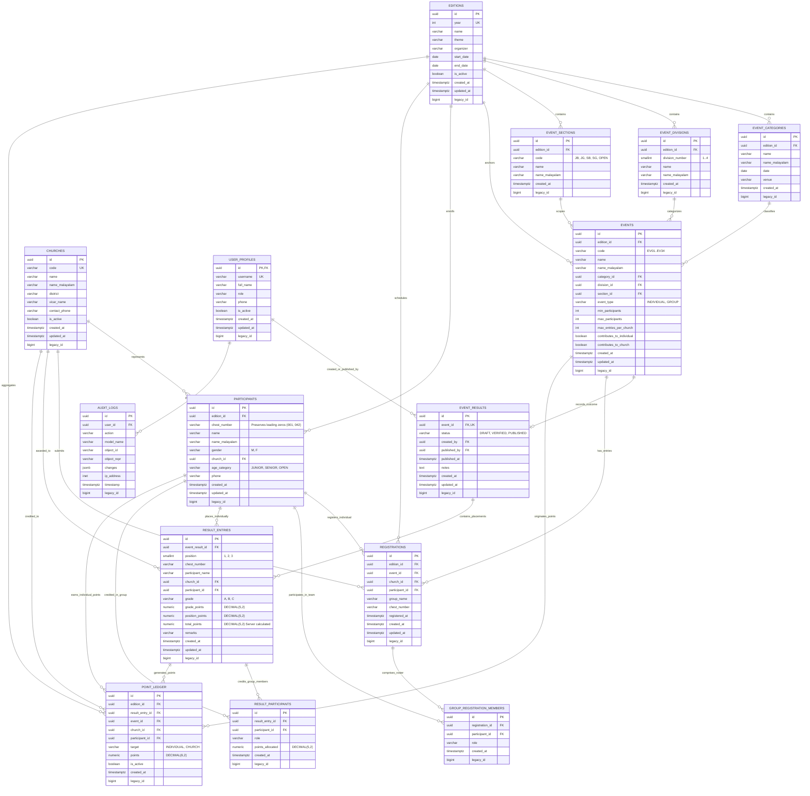

# ZIMRAH 2026 – Supabase PostgreSQL Database Schema & Architecture

**Project:** ZIMRAH 2026 – Song of Praise  
**Database:** Supabase PostgreSQL 15+  
**Architecture Reference:** ADR-001, ADR-003, ADR-004, ADR-005, ADR-006  
**Status:** Validated & Tested (24/24 Automated Assertions Passed)  

---

## 1. Entity-Relationship (ER) Diagram

---

## 2. Database Tables & Specifications

### 2.1 `editions`
The root anchor for a festival year.
- `id` (UUID, PK, `DEFAULT gen_random_uuid()`)
- `year` (INTEGER, UNIQUE, NOT NULL): Festival year (e.g., 2026).
- `name` (VARCHAR(100), NOT NULL, DEFAULT `'ZIMRAH 2026'`): Official title.
- `theme` (VARCHAR(150), NOT NULL, DEFAULT `'Song of Praise'`): Festival slogan.
- `organizer` (VARCHAR(200), NOT NULL): Diocesan council / youth movement.
- `start_date` (DATE): 2026-11-08 (Literary Events).
- `end_date` (DATE): 2026-11-14 (Stage Events).
- `is_active` (BOOLEAN, NOT NULL, DEFAULT `TRUE`): Determines active edition for public scoreboard.
- `created_at`, `updated_at` (TIMESTAMPTZ, NOT NULL, DEFAULT `now()`).
- `legacy_id` (BIGINT, UNIQUE, NULL): Traceable integer ID from Django.

### 2.2 `user_profiles`
Administrative profiles linked to Supabase Auth (`auth.users`).
- `id` (UUID, PK, FK to `auth.users(id)` ON DELETE CASCADE).
- `username` (VARCHAR(150), UNIQUE, NOT NULL).
- `full_name` (VARCHAR(255), NOT NULL, DEFAULT `''`).
- `role` (VARCHAR(20), NOT NULL, DEFAULT `'RESULT_ADMIN'`): `CHECK (role IN ('SUPER_ADMIN', 'RESULT_ADMIN', 'PUBLISHER'))`.
- `phone` (VARCHAR(20), NOT NULL, DEFAULT `''`).
- `is_active` (BOOLEAN, NOT NULL, DEFAULT `TRUE`).
- `created_at`, `updated_at` (TIMESTAMPTZ, NOT NULL, DEFAULT `now()`).
- `legacy_id` (BIGINT, UNIQUE, NULL).

### 2.3 `churches`
Registry of participating parish churches under the Adoor Clergy District.
- `id` (UUID, PK, `DEFAULT gen_random_uuid()`).
- `code` (VARCHAR(20), UNIQUE, NOT NULL): e.g., `CH01`, `CH02`.
- `name` (VARCHAR(150), NOT NULL): Official English name.
- `name_malayalam` (VARCHAR(200), NOT NULL, DEFAULT `''`): Malayalam name.
- `district` (VARCHAR(100), NOT NULL, DEFAULT `'Adoor Clergy District'`).
- `vicar_name` (VARCHAR(120), NOT NULL, DEFAULT `''`).
- `youth_leader_name` (VARCHAR(120), NOT NULL, DEFAULT `''`).
- `contact_phone` (VARCHAR(25), NOT NULL, DEFAULT `''`).
- `contact_email` (VARCHAR(254), NOT NULL, DEFAULT `''`).
- `is_active` (BOOLEAN, NOT NULL, DEFAULT `TRUE`).
- `created_at`, `updated_at` (TIMESTAMPTZ, NOT NULL, DEFAULT `now()`).
- `legacy_id` (BIGINT, UNIQUE, NULL).

### 2.4 `participants`
Contestants registered for the festival.
- `id` (UUID, PK, `DEFAULT gen_random_uuid()`).
- `edition_id` (UUID, NOT NULL, FK to `editions(id)` ON DELETE CASCADE).
- `chest_number` (VARCHAR(20), NOT NULL): **ADR-005: Preserves leading zeros (`001`, `042`)**.
- `name` (VARCHAR(150), NOT NULL).
- `name_malayalam` (VARCHAR(150), NOT NULL, DEFAULT `''`).
- `gender` (VARCHAR(1), NOT NULL): `CHECK (gender IN ('M', 'F'))`.
- `church_id` (UUID, NOT NULL, FK to `churches(id)` ON DELETE RESTRICT).
- `age_category` (VARCHAR(10), NOT NULL, DEFAULT `'OPEN'`): `CHECK (age_category IN ('JUNIOR', 'SENIOR', 'OPEN'))`.
- `phone` (VARCHAR(25), NOT NULL, DEFAULT `''`).
- `created_at`, `updated_at` (TIMESTAMPTZ, NOT NULL, DEFAULT `now()`).
- `legacy_id` (BIGINT, UNIQUE, NULL).
- **Constraints**: `UNIQUE (edition_id, chest_number)`.

### 2.5 `event_categories`, `event_divisions`, `event_sections`
Classification hierarchy for competitions.
- `event_categories`: Literary Events (off-stage, Thazhathmon) and Stage Events (on-stage, Munroethuruth). `UNIQUE (edition_id, name)`.
- `event_divisions`: 1: Music, 2: Fine Arts, 3: Theater, 4: Writing & Elocution. `UNIQUE (edition_id, division_number)`.
- `event_sections`: Age/gender sub-sections (`JB`, `JG`, `SB`, `SG`, `JUNIOR`, `SENIOR`, `OPEN`). `UNIQUE (edition_id, code)`.

### 2.6 `events`
Official catalog of 34 competitions.
- `id` (UUID, PK, `DEFAULT gen_random_uuid()`).
- `edition_id` (UUID, NOT NULL, FK to `editions(id)` ON DELETE CASCADE).
- `code` (VARCHAR(20), NOT NULL): `EV01` through `EV34`.
- `name` (VARCHAR(150), NOT NULL).
- `name_malayalam` (VARCHAR(200), NOT NULL).
- `category_id` (UUID, NOT NULL, FK to `event_categories(id)` ON DELETE RESTRICT).
- `division_id` (UUID, NULL, FK to `event_divisions(id)` ON DELETE RESTRICT).
- `section_id` (UUID, NULL, FK to `event_sections(id)` ON DELETE RESTRICT).
- `event_type` (VARCHAR(20), NOT NULL, DEFAULT `'INDIVIDUAL'`): `CHECK (event_type IN ('INDIVIDUAL', 'GROUP'))`.
- `duration_minutes` (INTEGER, NULL).
- `duration_display` (VARCHAR(50), NOT NULL, DEFAULT `''`).
- `min_participants` (INTEGER, NOT NULL, DEFAULT 1): `CHECK (min_participants >= 1)`.
- `max_participants` (INTEGER, NOT NULL, DEFAULT 1): `CHECK (max_participants >= 1)`.
- `max_entries_per_church` (INTEGER, NOT NULL, DEFAULT 1).
- `contributes_to_individual` (BOOLEAN, NOT NULL, DEFAULT `TRUE`).
- `contributes_to_church` (BOOLEAN, NOT NULL, DEFAULT `TRUE`).
- `created_at`, `updated_at` (TIMESTAMPTZ, NOT NULL, DEFAULT `now()`).
- `legacy_id` (BIGINT, UNIQUE, NULL).
- **Constraints**: `UNIQUE (edition_id, code)`, `CHECK (max_participants >= min_participants)`.

### 2.7 `registrations` & `group_registration_members`
Contestant enrollments and group team rosters.
- `registrations`: Anchors an entry for an event by a church team or individual contestant.
- `group_registration_members`: Roster of registered participants forming a group competition team. `UNIQUE (registration_id, participant_id)`.

### 2.8 `event_results`
Competition result master record with publishing state machine.
- `id` (UUID, PK, `DEFAULT gen_random_uuid()`).
- `event_id` (UUID, NOT NULL, UNIQUE, FK to `events(id)` ON DELETE RESTRICT).
- `status` (VARCHAR(20), NOT NULL, DEFAULT `'DRAFT'`): `CHECK (status IN ('DRAFT', 'VERIFIED', 'PUBLISHED'))`.
- `created_by` (UUID, NULL, FK to `user_profiles(id)` ON DELETE SET NULL).
- `published_by` (UUID, NULL, FK to `user_profiles(id)` ON DELETE SET NULL).
- `published_at` (TIMESTAMPTZ, NULL).
- `notes` (TEXT, NOT NULL, DEFAULT `''`).
- `created_at`, `updated_at` (TIMESTAMPTZ, NOT NULL, DEFAULT `now()`).
- `legacy_id` (BIGINT, UNIQUE, NULL).

### 2.9 `result_entries`
Awarded placement score rows.
- `id` (UUID, PK, `DEFAULT gen_random_uuid()`).
- `event_result_id` (UUID, NOT NULL, FK to `event_results(id)` ON DELETE CASCADE).
- `position` (SMALLINT, NULL): `CHECK (position IN (1, 2, 3))`.
- `chest_number` (VARCHAR(20), NOT NULL).
- `participant_name` (VARCHAR(150), NOT NULL).
- `church_id` (UUID, NOT NULL, FK to `churches(id)` ON DELETE RESTRICT).
- `participant_id` (UUID, NULL, FK to `participants(id)` ON DELETE RESTRICT).
- `grade` (VARCHAR(5), NOT NULL, DEFAULT `''`): `CHECK (grade IN ('', 'A', 'B', 'C'))`.
- `grade_points` (DECIMAL(5,2), NOT NULL, DEFAULT `0.00`): `CHECK (grade_points >= 0)`.
- `position_points` (DECIMAL(5,2), NOT NULL, DEFAULT `0.00`): `CHECK (position_points >= 0)`.
- `total_points` (DECIMAL(5,2), NOT NULL, DEFAULT `0.00`): **Enforced by database trigger: Total = Grade + Position (ADR-006)**.
- `remarks` (VARCHAR(255), NOT NULL, DEFAULT `''`).
- `created_at`, `updated_at` (TIMESTAMPTZ, NOT NULL, DEFAULT `now()`).
- `legacy_id` (BIGINT, UNIQUE, NULL).

### 2.10 `result_participants`
Group competition participant attribution.
- `id` (UUID, PK, `DEFAULT gen_random_uuid()`).
- `result_entry_id` (UUID, NOT NULL, FK to `result_entries(id)` ON DELETE CASCADE).
- `participant_id` (UUID, NOT NULL, FK to `participants(id)` ON DELETE RESTRICT).
- `role` (VARCHAR(50), NOT NULL, DEFAULT `''`).
- `points_allocated` (DECIMAL(5,2), NOT NULL, DEFAULT `0.00`): **ADR-004 Individual points credited from team placement**.
- `created_at` (TIMESTAMPTZ, NOT NULL, DEFAULT `now()`).
- `legacy_id` (BIGINT, UNIQUE, NULL).
- **Constraints**: `UNIQUE (result_entry_id, participant_id)`.

### 2.11 `point_ledger`
Authoritative points ledger for church and individual championship leaderboards.
- `id` (UUID, PK, `DEFAULT gen_random_uuid()`).
- `edition_id` (UUID, NOT NULL, FK to `editions(id)` ON DELETE CASCADE).
- `result_entry_id` (UUID, NOT NULL, FK to `result_entries(id)` ON DELETE CASCADE).
- `event_id` (UUID, NOT NULL, FK to `events(id)` ON DELETE RESTRICT).
- `church_id` (UUID, NOT NULL, FK to `churches(id)` ON DELETE RESTRICT).
- `participant_id` (UUID, NULL, FK to `participants(id)` ON DELETE RESTRICT).
- `target` (VARCHAR(20), NOT NULL): `CHECK (target IN ('INDIVIDUAL', 'CHURCH'))`.
- `points` (DECIMAL(6,2), NOT NULL, DEFAULT `0.00`): `CHECK (points >= 0)`.
- `is_active` (BOOLEAN, NOT NULL, DEFAULT `TRUE`): Active points count in leaderboard totals; deactivated on unpublish.
- `created_at` (TIMESTAMPTZ, NOT NULL, DEFAULT `now()`).
- `legacy_id` (BIGINT, UNIQUE, NULL).

### 2.12 `audit_logs`
Activity and change history trail.
- `id` (UUID, PK, `DEFAULT gen_random_uuid()`).
- `user_id` (UUID, NULL, FK to `user_profiles(id)` ON DELETE SET NULL).
- `action` (VARCHAR(50), NOT NULL).
- `model_name` (VARCHAR(100), NOT NULL).
- `object_id` (VARCHAR(50), NOT NULL, DEFAULT `''`).
- `object_repr` (VARCHAR(200), NOT NULL, DEFAULT `''`).
- `changes` (JSONB, NOT NULL, DEFAULT `'{}'::jsonb`).
- `ip_address` (INET, NULL).
- `timestamp` (TIMESTAMPTZ, NOT NULL, DEFAULT `now()`).
- `legacy_id` (BIGINT, UNIQUE, NULL).

---

## 3. Database Indexes Documentation

| Index Name | Table | Columns | Query Purpose / Optimization |
|:---|:---|:---|:---|
| `idx_editions_year` | `editions` | `year` | Quick year lookup for multi-edition archives |
| `idx_editions_is_active` | `editions` | `is_active` | Live edition resolution on public entrypoint |
| `idx_churches_code` | `churches` | `code` | Unique church identification and route lookup |
| `idx_churches_name` | `churches` | `name` | Search bar autocompletion |
| `idx_churches_is_active` | `churches` | `is_active` | Active parish filtering |
| `idx_participants_edition_chest` | `participants` | `edition_id, chest_number` | Unique chest number lookups within edition |
| `idx_participants_edition_church`| `participants` | `edition_id, church_id` | Parish contestant team rosters |
| `idx_participants_name` | `participants` | `name` | Live contestant search queries |
| `idx_participants_chest` | `participants` | `chest_number` | Fast search by chest number prefix/exact match |
| `idx_participants_age_gender` | `participants` | `age_category, gender` | Kalaprathibha / Kalathilakam division filtering |
| `idx_events_edition_code` | `events` | `edition_id, code` | Competition scorecard lookups (`/results/:code`) |
| `idx_events_edition_category` | `events` | `edition_id, category_id` | Literary vs Stage schedule grouping |
| `idx_events_edition_division` | `events` | `edition_id, division_id` | Division tabs (Music, Fine Arts, Theater, Literary) |
| `idx_registrations_edition_event`| `registrations` | `edition_id, event_id` | Stage sheets and judge roster generation |
| `idx_registrations_edition_church`| `registrations` | `edition_id, church_id` | Church delegation rosters |
| `idx_event_results_status` | `event_results` | `status` | Public filtering for published scorecards only |
| `idx_event_results_updated` | `event_results` | `updated_at DESC` | Latest results feed and live tickers |
| `idx_result_entries_event_pos` | `result_entries` | `event_result_id, position` | Scorecard podium ordering (1st, 2nd, 3rd) |
| `idx_result_entries_church` | `result_entries` | `church_id` | Parish points calculation |
| `idx_result_entries_chest` | `result_entries` | `chest_number` | Participant placement history |
| `idx_point_ledger_edition_target_active` | `point_ledger` | `edition_id, target, is_active` | **Critical Leaderboard Index: Sums points in <10ms** |
| `idx_point_ledger_church_active`| `point_ledger` | `church_id, is_active` | Church championship aggregation |
| `idx_point_ledger_participant_active` | `point_ledger` | `participant_id, is_active` | Individual championship aggregation |
| `idx_audit_logs_timestamp` | `audit_logs` | `timestamp DESC` | Recent administrative activity timeline |
